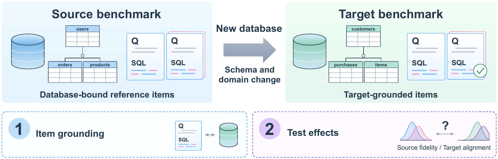

# Schema2Bench

**Evidence-Grounded Cross-Domain Text-to-SQL Benchmark Migration**

Schema2Bench (S2B) migrates Text-to-SQL evaluation workloads to new relational
databases through three modules. **Benchmark Construction** grounds source SQL
patterns in target schemas and sampled values, then generates questions.
**Workload Selection** adjusts structural composition under fixed quotas, bounds
changes in source fidelity and identifies candidate-pool deficits.
**Benchmark Evaluation** separately measures source fidelity and agreement with
model accuracy gaps on target references.

This repository accompanies [manuscript v42](paper/Schema2Bench_ICDE2027_v42.pdf)
(12 body pages, 15 pages including the AI-use disclosure and references).
The retained identifier `refill` in data, filenames and replay output denotes S2B.



The main study compares five constructions on eight databases from BIRD with ten models,
2,000 tasks per method and 906 target references. Under Verified execution
scoring and the declared weights, S2B improves source fidelity over all four
comparators and reduces Template's target-gap error from 0.225 to 0.169.
Ring, Omni and Synth have lower target gap than S2B; Ring also has lower mean
selection regret. Most improvement over Template precedes workload selection.
Under execution scoring, rewriting questions with SQL fixed improves
target alignment but reduces source fidelity. A uniform semantic review leaves
both directions unresolved when sampled concerns are treated as unknown scores.

Spider supplies the source query structures and source model responses.
Earlier experiments on Chinook, IMDb, Instacart, SFDFFD, TPC-DS, TPC-H and
USAccidents evaluate repair and bounded selection with a separate seven-model
panel. Their [archived results](docs/historical.md) are reported separately.
Additional studies use BIRD's `student_club` database and four SynSQL-2.5M
databases for value-sampling controls, including the garment database for
candidate generation. External evaluations use three databases each from TACO
and BEAVER. BIRD Mini-Dev provides revised reference tasks on the original eight
databases. These studies have different sample sizes and construction settings;
the five-method comparison is the main BIRD experiment.

## Start with the saved results

Python 3.10 or newer is recommended. These commands use the standard library;
they do not need a GPU, database download or API key.

```bash
python3 scripts/verify_manifest.py
python3 scripts/replay_main.py
python3 scripts/recount_semantic.py
python3 scripts/replay_witness.py
python3 scripts/replay_followup.py
python3 scripts/recount_historical.py
```

The main replay recomputes both scoring layers for all ten releases and compares
the tables and direct method contrasts with the archived values. It prints one
confirmation per release. Semantic recount checks the counts of 4,000 archived
API judgments without validating their semantic correctness;
the witness replay checks the saved binary assignment used in the reference-risk
analysis. The follow-up replay checks the BEAVER schema-context comparison and
the uniform semantic sensitivity. See [reproduction instructions](docs/reproduction.md) for expected
outputs and additional commands.

## Contents

| Directory | Contents |
| --- | --- |
| `src/schema2bench/` | SQL construction, schema profiling, planning and question-generation components |
| `selection/` | Quota allocation, bounded exchanges, candidate metadata and saved releases |
| `diagnostics/` | Structural support analysis and a small worked example |
| `evaluation/` | Execution scorer, proof records, semantic prompt and archived labels |
| `data/` | Task sets, shared prompt prefixes and compact model-output records |
| `replay/` | Score matrices, membership lists and executable result checks |
| `figures/` | Current figures, editable sources for Figures 1-2, and plotting code/data for Figures 3-6 |
| `configs/` | Model fingerprints, database hashes and experiment settings |
| `paper/` | v42 manuscript PDF, source and fixed figure assets |

[Data formats](docs/data.md) explain the record fields and scoring layers.
[Paper-to-artifact mapping](docs/paper-map.md) identifies which results can be
recomputed here and which are supplied as saved analyses.
[External and semantic checks](docs/followup.md) describe the additional evidence
in the current manuscript.

## Construction and selection

Install the optional analysis dependencies:

```bash
python3 -m pip install -r requirements.txt
python3 scripts/replay_selection.py --release 0
python3 scripts/check_difficulty_support.py
```

The selection replay reconstructs the first release from candidate SQL features
before comparing its IDs with the saved release. The difficulty check recovers
the 0.3775 lower bound and the capacity of 173 easy tasks under the fixed quotas.

A small example runs the construction components on an illustrative database:

```bash
python3 scripts/create_example.py
python3 scripts/generate_candidates.py --database results/shop.sqlite --output results/candidates.jsonl
```

This example creates candidates for inspection. It does not reconstruct the
paper's screened population or establish semantic correctness.

## Reproduction scope

The repository supports offline reanalysis of the retained records. Some
additional experiments are supplied as saved analyses or reported results only;
the [coverage map](docs/paper-map.md) specifies the available inputs for each.
Database
files, model weights and full token-ID arrays are excluded. The compressed
prediction files retain model output text, parsed SQL, termination information
and input hashes. Re-running SQL requires the database snapshots identified in
`configs/databases.json`; re-running inference also requires the model snapshots
and original runtime configuration.

The ten releases overlap and are not independent datasets. Ring, Omni and Synth
are local adaptations of their respective construction approaches. Semantic
labels are model judgments, not human annotations or calibrated confidence
scores. Base and Verified bounds represent unresolved execution scores, not
sampling confidence intervals.

## Paper and data sources

This repository accompanies the manuscript *Schema2Bench: Evidence-Grounded
Cross-Domain Text-to-SQL Benchmark Migration*. See `CITATION.cff` for its authors.

The experiments use [Spider](https://yale-lily.github.io/spider/) and
[BIRD](https://bird-bench.github.io/). Obtain databases and model weights through
their original distribution channels and follow the applicable terms.
The BEAVER follow-up uses the SQLite conversion distributed with
[CORE-T](https://github.com/UKPLab/emnlp2026-core-t). Only derived score records
from that pilot are included here; its questions, SQL and database contents are
obtained from the upstream distribution.

## Build the manuscript

With TeX Live (including IEEEtran) and `latexmk` installed:

```bash
sh paper/build.sh
```

The PDF is written to `paper/build/main.pdf`. The build uses the supplied v42
figures and does not rerun experiments or require plotting dependencies.
The archived [v42 PDF](paper/Schema2Bench_ICDE2027_v42.pdf) and its SHA-256 are
identified in `provenance/manuscript.json`.
